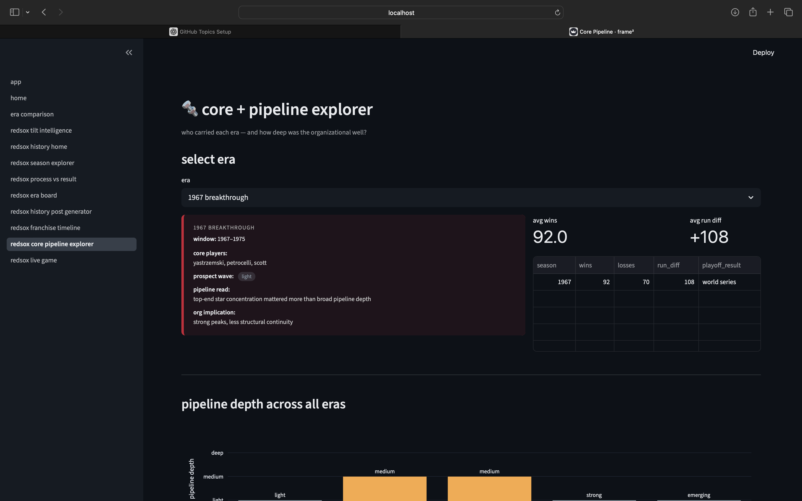
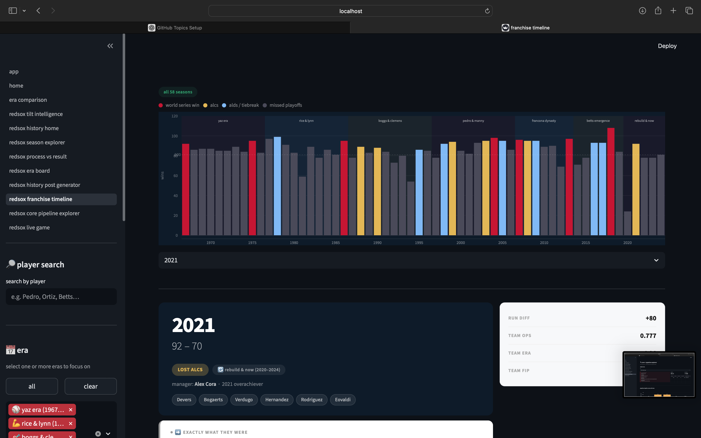
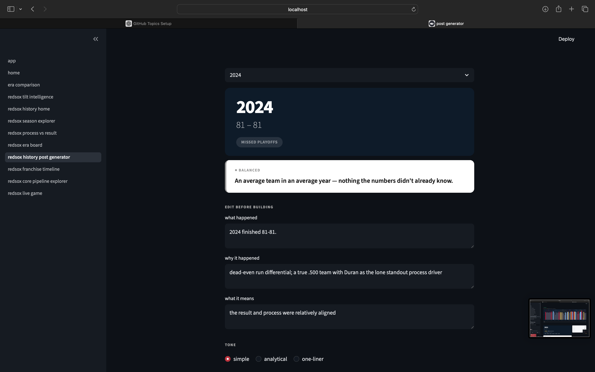

# frame² — sports intelligence engine


[](LICENSE)
[](https://github.com/dualityframework-ux/frame2_mvp/actions/workflows/ci.yml)

frame² is a lightweight sports analytics and content engine built to explain games through **process vs result**.

the goal is simple:

**observe → detect the edge → explain the mechanism → generate insights**

---

## Development and documentation

This is the canonical sports repository. The previous
[Red Sox history repository](https://github.com/dualityframework-ux/frame2-redsox-history)
is retained as a legacy snapshot. See the [history guide](docs/HISTORY_GUIDE.md)
for the dataset schema, process-tag rules, exports, hosting and comparison record.

## demo

example output generated by frame²:

observation  
2024 red sox finished 81-81.

mechanism  
run differential was neutral, but the offense relied heavily on duran as the lone consistent process driver.

implication  
the result and underlying process were aligned — an average team produced an average outcome.

---

## core ideas

most fans watch the scoreboard.

frame² tries to explain **why the scoreboard moved**.

the engine focuses on identifying hidden drivers such as:

- contact quality
- plate discipline
- run expectancy swings
- roster structure
- development pipeline

these signals help reveal the **mechanism behind outcomes**.

---

## features

### red sox intelligence dashboard

explore historical eras and identify what drove each team’s success.

### franchise timeline

visualize the full history of the franchise, including:

- world series seasons
- playoff runs
- rebuilding periods
- emerging cores

### core + pipeline explorer

see which players carried each era and how strong the organizational pipeline was.

### history post generator

automatically convert analytics into ready-to-post insights.

---

## screenshots

### core + pipeline explorer

<p align="center">

</p>

### franchise timeline

<p align="center">

</p>

### history post generator

<p align="center">

</p>

---

## Feature status

- **Available:** historical season analytics, franchise timelines, post generation,
  PDF and presentation exports.
- **Manual simulator:** the game page uses the values you enter; it is not a live feed.
- **Experimental:** the Statcast adapter; automated ingest and tilt agents are placeholders.

## roadmap

planned upgrades for frame²:

- live game ingestion
- automated tilt detection
- multi-sport support (nba / nfl / mlb)
- real-time insight generation
- integration with social publishing pipelines

---

## project structure

```
frame2_mvp/
├── app/
│   ├── app.py            # streamlit entry point
│   └── pages/            # dashboard pages (explorer, timeline, post generator, live game)
├── intelligence/         # signal / noise and process-vs-result logic
├── content_engine/       # insight → post generator
├── adapters/             # data loaders (history csv, mlb stats api)
├── agents/               # orchestrator that ties the engines together
├── config/               # settings, styles, utils
├── storage/parquet/      # red sox season data (1967–2024)
├── images/               # readme screenshots
├── tests/                # pytest suite
└── requirements.txt      # python dependencies
```

---

## run locally

```bash
git clone https://github.com/dualityframework-ux/frame2_mvp.git
cd frame2_mvp

pip install -r requirements.txt
PYTHONPATH=. streamlit run app/app.py
```

## tests

```bash
python -m pip install -r requirements-dev.txt
python -m compileall -q adapters agents app config content_engine intelligence memory models *.py
PYTHONPATH=. python -m pytest -q
```

The tests cover the adapters, settings, data integrity, the history and signal engines, the orchestrator and the post generator. github actions runs them on every push.

## license

mit — see [LICENSE](LICENSE).

The test suite includes offline Statcast fixtures and actual HTML, PDF, and PPTX
export generation. Network ingestion is mocked in tests.
